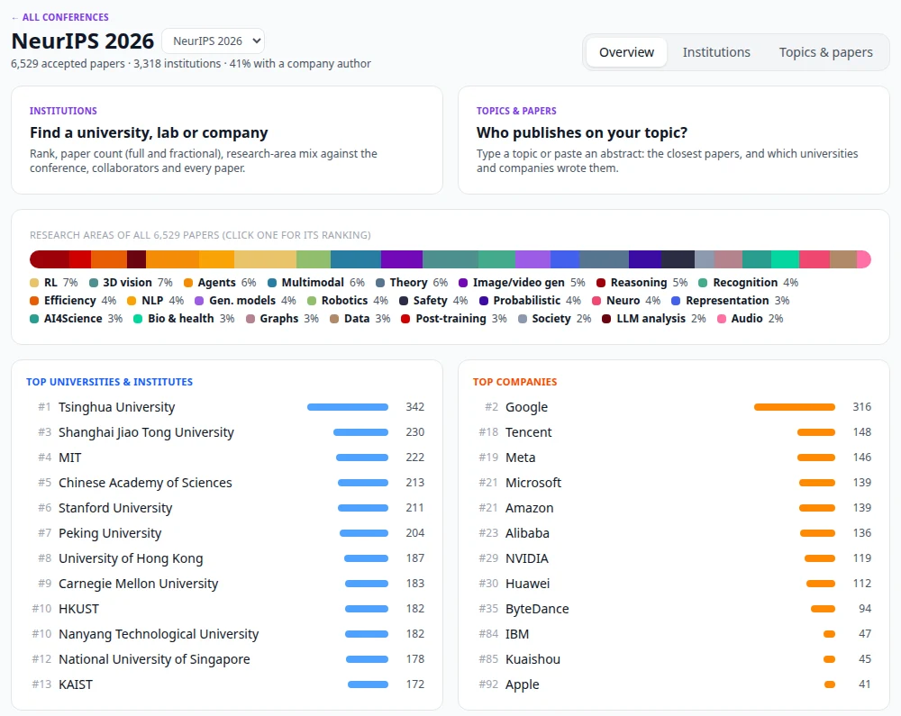

# Conference explorer

The **Conferences** tab browses the accepted papers of the major ML, vision, NLP and robotics
conferences two ways: by **institution** (where does a university, lab or company rank, what
does it publish on, with whom) and by **topic** (type a topic or paste an abstract: which
universities and companies publish most on it, and which papers are closest). It works for
every conference-year in the list below, not one fixed conference, and runs entirely on your
own server.

---

## Which conferences

| Field | Conferences | Source |
|---|---|---|
| ML | NeurIPS 2020–2026, ICML 2022–2026, ICLR 2022–2026 | official conference site |
| ML | AISTATS, UAI, COLT | Paper Copilot |
| Vision | CVPR 2023–2026, ICCV 2025, ECCV 2024 and 2026 | official conference site |
| Vision | CVPR 2022, ICCV 2021/2023, ECCV 2022, WACV | Paper Copilot |
| NLP | ACL, EMNLP, NAACL, COLM | Paper Copilot |
| General AI | AAAI, IJCAI | Paper Copilot |
| Robotics | CoRL, RSS, ICRA, IROS | Paper Copilot |
| Data | KDD, WWW | Paper Copilot |

**Official conference sites.** NeurIPS, ICML, ICLR, CVPR, ICCV and ECCV publish every accepted
paper as one JSON file, with authors, each author's institution (92–98 % of authors carry one),
abstract, decision (poster, spotlight, oral), session and the OpenReview link.

**[Paper Copilot](https://github.com/papercopilot/paperlists)** keeps paper lists for the
other venues and older years. Most come with normalised affiliations; a few (ACL 2025, recent
OpenReview venues that hide them) do not, and for those the page says the institution views
are thin and the topic view is the useful one. Rejected and withdrawn submissions are dropped.

Some sites serve only the first page of their list without a login (CVPR 2026 at the time of
writing: 199 of 5,163 papers with authors). The titles of the rest come from the site's public
paper list, so topic search still covers the whole conference, and the page says for how many
papers institutions are known.

---

## Loading a conference

The first time you open a conference that is not loaded, PaperManager downloads its list and
indexes it in the background; the page shows the progress and fills in as it goes:

1. **Downloading** the list (a few seconds).
2. **Reading**: institution names are normalised and counted. The institution views work from
   here on.
3. **Indexing**: every title and abstract is embedded with
   [bge-small-en-v1.5](https://huggingface.co/BAAI/bge-small-en-v1.5) on the CPU, which gives the
   research areas and semantic topic search. About two minutes for NeurIPS 2026 (6,500 papers,
   titles only so far), three for a conference with abstracts.

A default set is loaded when the backend starts (see [Settings](#settings)), so the main
conferences are ready without anyone waiting. **refresh** at the bottom of a conference page
downloads it again; this year's conferences are also refreshed automatically every two weeks,
since the sites keep adding abstracts, sessions and late papers until the meeting.

---

## Overview

Paper count, institution count and the share of papers with at least one company author; the
research-area mix of the whole conference (click an area for its institution ranking); the top
universities and institutes, and the top companies.

## Institutions

A ranked table of every institution, searchable by name, filterable by academia / industry and
by research area. With an area selected the table ranks by papers in that area and shows what
share of each institution's own papers that area is ("of own").

Click a row for the institution card:

- **Rank** overall and among universities or companies, **papers**, **fractional papers** and
  **share** of the conference.
- **Research areas** against the whole conference: the thin bar under the institution's bar is the
  conference's mix, and areas the institution publishes in at least twice the conference rate are
  marked ×2.0, ×3.1, ...
- **Most frequent co-authoring institutions** and the authors with the most papers there.
- **Every paper**, orals and spotlights first; click an area in the legend to filter.

## Topics & papers

Type a topic ("RL for LLM reasoning", "diffusion models for protein structure") or paste a whole
abstract. The query is embedded with the same model, the closest 50 / 100 / 200 / 500 papers are
taken, and the page shows:

- their **research-area mix** and how many have a company author;
- the **universities & institutes** and the **companies** with the most of those papers (hover for
  what share of the institution's papers at the conference that is);
- the **closest papers**, each with its match score, area, decision, session and institutions.

Short queries get bge's retrieval instruction ("Represent this sentence for searching relevant
passages: ..."); a pasted abstract is embedded as is. Until a conference is indexed, topic
search falls back to keyword matching on titles and abstracts and says so.

Short queries go into the URL (`/conferences/neurips2026?view=topics&q=video%20generation`), so a
result can be shared or bookmarked.

## Papers and your library

Every paper row shows **In library** when a paper with the same title is already in your library
(it links to it), and **+ Library** otherwise. Adding creates the paper with its title, abstract,
venue ("NeurIPS 2026"), year and authors (each with their institution as affiliation), tagged
`from-conference`. Upload the PDF later from the paper page for the full pipeline. Click a title
for the abstract, the author list with institutions and the eight closest papers at the same
conference; ↗ opens the paper on the conference site.

---

## How things are counted

- **Papers**: a paper counts once for every institution with at least one author on it. A paper
  by MIT and Google counts for both.
- **Fractional**: each author is 1/n of a paper (n authors), split equally over that author's
  institutions. Fractional counts sum to the number of papers with affiliations.
- **Rank**: by papers, ties share a rank.
- **Institution names** are normalised: HTML entities and full-width letters are cleaned,
  department names dropped ("Department of Computer Science, ETH Zurich" → ETH Zurich), several
  affiliations in one field split ("Google, TUM" → Google and TU Munich), and spellings merged.
  About 220 alias rules merge the common cases: Google with DeepMind, Meta with FAIR, the
  institutes of the Chinese Academy of Sciences, campus spellings ("University of California,
  Berkeley", "UC Berkeley"), acronyms (MIT, CMU, KAIST, EPFL). Everything else keeps its own
  spelling and is merged by case, accents and punctuation.
- **Academia / industry**: aliases carry it; otherwise a name with "university", "institute",
  "college", "laboratory", "hospital", ... is academia, anything else a company. Non-profit
  institutes (Allen Institute for AI, Mila, Max Planck, Shanghai AI Laboratory) count as academia.
  "Independent researcher" is not counted.
- **Research areas** are one fixed taxonomy of 24 areas for every conference, so the mix of
  NeurIPS and ICML can be compared and an area keeps its colour everywhere. Each paper gets the
  area whose description is closest to its embedding, after both are centred on the conference's
  mean paper vector; the area centres are then moved halfway towards their papers twice. Areas
  are a coarse map, not a label: a paper on, say, RL for theorem proving lands in one area only.

A wrong institution mapping is fixed by an alias line in
`backend/services/conferences/institutions.py`.

---

## From Claude (MCP)

Three [MCP tools](mcp-server.md) expose the same data to Claude Desktop and Claude Code:

| Tool | Answers |
|---|---|
| `list_conferences` | Which conference-years are loaded, with paper and institution counts |
| `conference_topic` | Who publishes on a topic at a conference: top universities and companies, area mix, closest papers |
| `conference_institution` | What one institution published at a conference: rank, counts, area mix against the conference, collaborators, authors, papers |

`conference` takes a key (`neurips2026`), a name (`ICML 2025`) or a bare series (`iclr` = its
latest year). Papers already in your library come back with their `library_paper_id`.

---

## Settings

All optional; set them in `.env` and pass them to the backend in `docker-compose.yml`.

| Variable | Default | What it does |
|---|---|---|
| `CONFERENCES_AUTO` | `true` | Load the default conferences at startup |
| `CONFERENCES_DEFAULT` | `neurips2026,icml2026,iclr2026,cvpr2026,iccv2025,eccv2026,neurips2025,acl2025` | Which ones |
| `CONFERENCES_REFRESH_DAYS` | `14` | Reload this year's default conferences when older than this |
| `CONFERENCE_DATA_DIR` | `/data/conferences` | Where datasets and the model live (the backend's volume) |
| `CONFERENCE_EMBED_THREADS` | `4` | CPU threads for embedding |

Each conference takes 5–30 MB on disk (papers, institutions, float16 embeddings); the model
takes 130 MB once. No API key is involved and nothing is sent anywhere except the download
of the paper lists and, once, the model.
