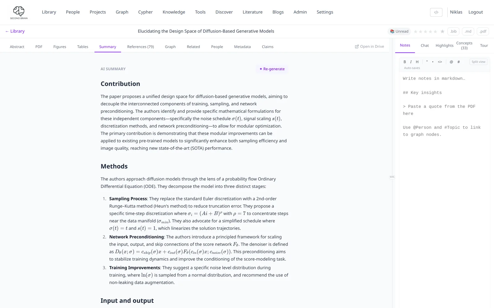

# First steps

This page takes one paper from upload to concept map. It assumes PaperManager is already
running and you can log in; if not, start with [Hosting your own](../self_hosting.md).

Plan about ten minutes, most of it waiting for the AI steps to finish in the background.

## 1. Add a paper

1. Open **Library** (the first item in the top menu).
2. Click **+** (*Add paper*). Drag a PDF into the drop zone, or paste a link such as
   `https://arxiv.org/abs/2206.00364`.
3. PaperManager looks up title, authors, year and DOI on Semantic Scholar and CrossRef. A badge
   shows where the details came from; yellow or red means *please check*.
4. Fix anything that is wrong and confirm.

The paper appears in your library straight away. Summary, topics, figures and references
are added in the background over the next minute or two.

!!! tip "Many papers at once"
    Drop several PDFs at once, or click **+ → Import multiple papers at once** and paste a list
    of DOIs, arXiv IDs or URLs. See [Ingesting papers](ingestion.md).

## 2. Open it and read

Click the paper. The view has two halves:

| Left side | Right side |
|---|---|
| PDF, abstract, **summary**, figures, tables, references, related papers, claims | **Notes**, **Chat**, **Highlights**, **Concepts**, **Tour** |

Try these in order:

- **Summary** (left): the AI summary of the whole paper.
- **Figures** (left): every figure with its caption; ask a question about one.
- **Chat** (right): ask anything about this paper, e.g. *"What is the main limitation?"*
- **Highlights**: select text in the PDF to highlight it in a colour; highlights are listed here.

{ .pm-shot }

## 3. Let it explain the paper

Two tabs on the right help with hard papers. Both are explained in
[Concepts, tour and concept map](reading-tools.md).

- **Tour → Make a quick tour.** You get an overview, a list of sections you can skip, and
  6–12 stops. Click a stop (or use ← / →) and the PDF jumps to the passage it is about.
- **Concepts → Find concepts.** PaperManager marks ideas on the PDF pages that a picture
  explains better than text, and draws an animation, plot or formula breakdown for each one.

## 4. Put it in a project

1. Open **Projects**, type a name and click **Create**.
2. In the project, use *Search library to add a paper…* to add your paper (and a few more).
3. Click **Concept map**. Each paper's key concepts are extracted and joined into one graph.
   Concepts shared by several papers grow larger; the filters narrow it by author, year or
   kind of concept.

## 5. Ask across everything

Open **Knowledge** in the top menu and ask a question, for example:

```text
@project:MyThesis Which papers compare against diffusion baselines, and how do they differ?
```

The answer cites the papers it used. Leave out the `@project:` part to search the whole
library, or turn on web search for questions your papers do not cover. More in
[Knowledge features](knowledge-features.md).

## Where next

- [Library](library.md): search, filters and views
- [Reading a paper](paper-detail.md): every tab of the paper view
- [MCP server](mcp-server.md): use your library from Claude Desktop or Claude Code
