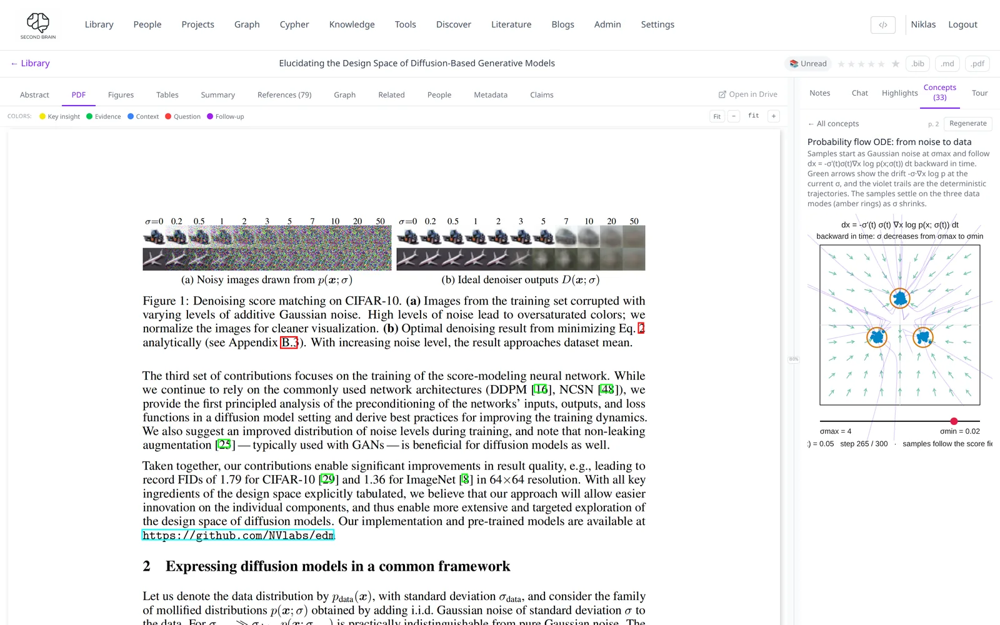
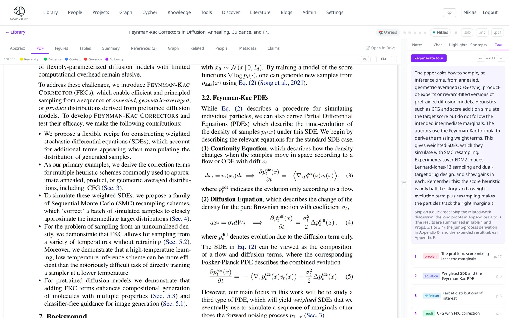
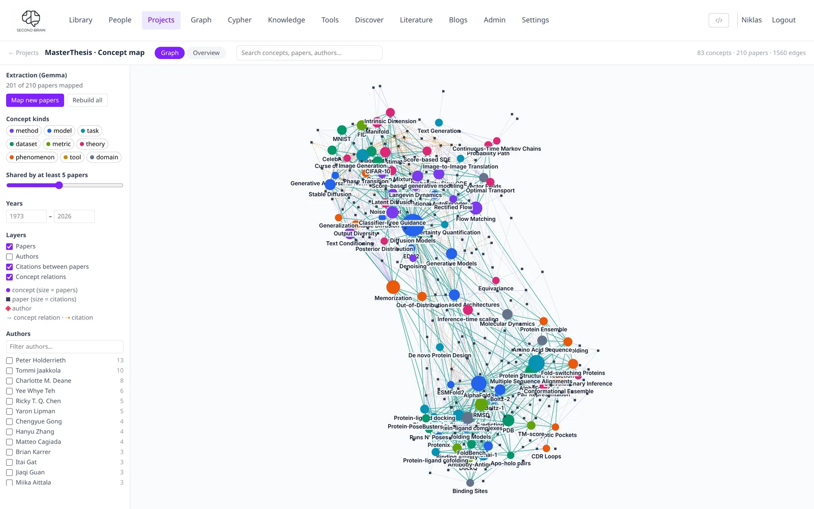

# Concepts, tour and concept map

Three tools help you understand papers rather than just store them. **Concepts** and the
**Tour** work on one paper; the **concept map** works on a whole project.

| Tool | Where | What you get | Needs |
|---|---|---|---|
| Concepts | Paper view → **Concepts** tab | Visual explanations of ideas, marked on the PDF page | Claude (subscription or API key) |
| Tour | Paper view → **Tour** tab | An overview and 6–12 stops through the PDF | Claude Code on a subscription |
| Concept map | Projects → a project → **Concept map** | One graph of the key concepts across all papers in the project | An OpenAI-compatible model (`LITELLM_*`) |

## Concepts

{ .pm-shot }

1. Open a paper with a PDF and switch to the **Concepts** tab.
2. Click **Find concepts**. The pages are read in batches; on each page, up to three ideas
   that a picture explains best are marked.
3. Click a concept to generate its visualisation, or **Generate all** for the rest.

Each concept gets one of four kinds of visualisation:

- **Formula**: an equation broken into its parts, with what each symbol means
- **Graph**: a plot drawn from data points (lines, points or bars)
- **Explanation**: a short structured text
- **Animation**: a small 2D animation, run in a sandboxed frame

Clicking a mark on the PDF opens its concept, and the other way round. This feature is adapted
from [Get It.](https://github.com/beltromatti/get-it) (Apache-2.0).

## Quick tour

{ .pm-shot }

Open the **Tour** tab and click **Make a quick tour**. After a minute you get:

- an **overview** of what the paper does and why it matters,
- **what to skip** on a first read,
- **6–12 stops**, each tied to an exact passage in the PDF, with a short explanation and the
  concepts it relies on.

Click a stop, or press ← / →, and the PDF scrolls to that passage and highlights it. The tour is
saved with the paper; **Regenerate tour** makes a new one.

!!! note "Setup"
    The tour runs Sonnet through Claude Code on a Claude subscription. Set
    `CLAUDE_CODE_OAUTH_TOKEN` (from `claude setup-token`) and `CLAUDE_CODE_USERS` in `.env`.
    Without them the button stays disabled; there is no API-key fallback.

## Concept map

{ .pm-shot }

The concept map shows what a set of papers is about and how the ideas connect.

- **Circles** are concepts; the colour is the kind (method, model, dataset, task, …) and the
  size is how many papers discuss it.
- **Papers** can be shown too, sized by citations, with their **authors** optional.
- **Lines** are typed relations from the papers: *is a*, *part of*, *uses*, *extends*,
  *improves on*, *alternative to*, *evaluated on* and more.
- **Filters** narrow the map by author, year, kind and the minimum number of papers per
  concept. The list beside the graph groups all concepts by kind.

Papers are mapped automatically: every ten minutes, PaperManager maps project papers that have
a summary but no concepts yet. **Map new papers** does it right away; **Rebuild all** starts
over. Set `CONCEPT_MAP_AUTO=false` to switch the automatic run off.

For each paper the model returns 6–15 concepts with the paper's role for each (*introduces*,
*extends*, *uses*, *evaluates*, *critiques* or *background*). It reuses names that already exist
in the project, so the same idea from two papers becomes one circle.
